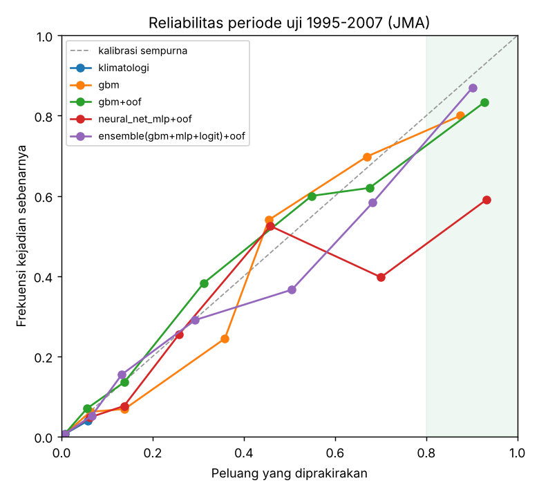

# Laporan Eksperimen Terratect

Prakiraan probabilistik gempa wilayah Jepang memakai waktu luruh (Omori-Utsu), keadaan geologi,
dan machine learning / deep learning. Semua angka di bawah berasal dari **periode uji yang tidak
pernah dilihat model saat dilatih**.

## Ringkasan

1. **Model lebih baik daripada menebak dengan rata-rata historis**, tapi selisihnya kecil.
   AUC naik dari 0,74 (klimatologi) menjadi 0,78 (GBM). Brier Skill Score positif, tapi hanya +1% s/d +3%.
2. **Klaim "peluang ≥ 80% = valid" belum terbukti.** Di periode uji 1995–2007, 25 dari 30 alarm
   ≥ 80% memang terjadi (83%, CI95 66–93%). Tapi 30 alarm itu hanya berasal dari **3 kejadian**
   (gempa susulan Sanriku-oki 1994, swarm Miyake-jima/Izu 2000, Tokachi-oki 2003). Di uji bergulir
   1965–1975, alarm ≥ 80% hanya benar **49%** dari waktu. Di 1975–1995, model tidak pernah mengeluarkan alarm ≥ 80%.
3. **Peluang tinggi hanya muncul saat gempa susulan atau swarm sedang aktif.** Tanpa fitur waktu luruh
   + aktivitas terbaru, model tidak pernah mencapai 80%. Hanya **~1%** gempa M5+ yang didahului alarm ≥ 80%.
4. **Deep learning (GRU/Transformer) setara dengan GBM, tidak lebih baik.** Transformer yang hanya
   membaca urutan gempa mentah berhasil "menemukan sendiri" pola peluruhan Omori (AUC 0,75, mendekati GBM 0,77).
   Tapi tidak ada model deep learning yang mengalahkan GBM.
5. **Gempa M ≥ 6 praktis tidak bisa diprakirakan lebih baik daripada klimatologi** (BSS ≈ 0).

## Data & metode

- **Data:** katalog JMA 1926–2007, 13.724 gempa dangkal M ≥ 4,5 (lihat [data/SUMBER.md](data/SUMBER.md)).
  b-value regional 0,77. Parameter peluruhan hasil fit dari 31 sekuens susulan: p = 1,04, c = 0,27 hari.
- **Unit prakiraan:** sel grid 1° × 1° (131 sel aktif). Pertanyaannya: "apakah akan terjadi gempa M ≥ 5
  di sel ini dalam 7 hari ke depan?" Prakiraan diterbitkan setiap 2 hari.
- **Pembagian waktu (default):** latih 1927–1984, kalibrasi 1985–1994, uji 1995–2007.
- **Metrik:**
  - AUC: kemampuan membedakan sel yang akan dan tidak akan terjadi gempa.
  - BSS (Brier Skill Score): perbaikan dibanding klimatologi; 0 = sama saja.
  - Presisi alarm ≥ 80% dengan CI95 Wilson.
  - **Episode:** alarm yang berdekatan (≤ 30 hari, ≤ 150 km) dihitung satu kejadian. Bukti sesungguhnya
    adalah jumlah episode, bukan jumlah alarm.

## A. Perbandingan model

Target M ≥ 5, 7 hari, sel 1°, uji 1995–2007. "+oof" = kalibrasi isotonik dari prediksi out-of-fold
seluruh sejarah 1927–1994. Tanpa "+oof" = kalibrasi hanya dari periode 1985–1994.

| Model | AUC | BSS | Alarm ≥80% | Presisi | CI95 | Recall | Episode (benar) |
|---|---|---|---|---|---|---|---|
| Klimatologi | 0,736 | 0 | 0 | – | – | 0% | 0 |
| Fisika Omori (logistik, 2 fitur) | 0,735 | +0,006 | 0 | – | – | 0% | 0 |
| Regresi logistik + oof | 0,778 | +0,017 | 65 | 46% | 35–58% | 1,5% | 3 (3) |
| GBM tanpa kalibrasi | 0,783 | +0,022 | 78 | 71% | 60–79% | 2,8% | 7 (7) |
| GBM (kalibrasi periode) | 0,767 | +0,025 | 5 | 80% | 38–96% | 0,2% | 1 (1) |
| **GBM + oof** | **0,783** | **+0,033** | 30 | **83%** | 66–93% | 1,3% | 3 (2) |
| Neural net MLP + oof | 0,776 | +0,019 | 22 | 59% | 39–77% | 0,7% | 1 (1) |
| Ensemble GBM+MLP+logistik + oof | 0,786 | +0,030 | 23 | 87% | 68–95% | 1,0% | 1 (1) |



Kalibrasi OOF jelas membantu. Kalibrasi dari satu periode 10 tahun hanya berisi sedikit sekuens
gempa besar, sehingga bin peluang tinggi tidak stabil. Pada percobaan pertama (tanpa OOF, tanpa
subsampel), model mengeluarkan 107 alarm ≥ 80% dan hanya 61% yang terjadi.

## B. Ablasi fitur (GBM + oof)

| Kelompok fitur | AUC | BSS | Alarm ≥80% | Presisi |
|---|---|---|---|---|
| Geologi saja | 0,734 | 0,000 | 0 | – |
| Waktu luruh saja | 0,743 | +0,017 | 0 | – |
| Waktu luruh + aktivitas terbaru | 0,755 | +0,031 | 35 | 83% |
| Waktu luruh + geologi | 0,769 | +0,014 | 0 | – |
| Semua | 0,783 | +0,033 | 30 | 83% |

- **Geologi** (jarak ke palung, b-value, kedalaman, laju latar) menentukan *di mana* gempa sering
  terjadi, sehingga menaikkan AUC. Tapi geologi tidak memberi informasi *kapan*, jadi BSS-nya ≈ 0.
- **Waktu luruh + aktivitas terbaru** memberi informasi *kapan*. Hanya kombinasi ini yang menghasilkan peluang tinggi.

## C. Definisi target (GBM + oof, uji 1995–2007)

| Target | Base rate | AUC | BSS | Alarm ≥80% | Presisi | Episode |
|---|---|---|---|---|---|---|
| M≥5, 1 hari, sel 1° | 0,1% | 0,811 | +0,035 | 1 | 100% | 1 |
| M≥5, 1 hari, sel 2° | 0,3% | 0,782 | +0,029 | 21 | 62% | 7 |
| M≥5, 7 hari, sel 1° | 0,6% | 0,783 | +0,033 | 30 | 83% | 3 |
| M≥5, 7 hari, sel 2° | 1,9% | 0,737 | +0,016 | 1 | 100% | 1 |
| M≥5, 30 hari, sel 1° | 2,5% | 0,761 | +0,012 | 13 | 46% | 2 |
| M≥5, 30 hari, sel 2° | 6,9% | 0,734 | −0,001 | 4 | 100% | 1 |
| M≥6, 1 hari, sel 1° | 0,01% | 0,757 | +0,003 | 0 | – | 0 |
| M≥6, 7 hari, sel 1° | 0,1% | 0,731 | +0,005 | 1 | 100% | 1 |
| M≥6, 30 hari, sel 1° | 0,4% | 0,662 | +0,004 | 0 | – | 0 |
| M≥6, 30 hari, sel 2° | 1,2% | 0,677 | −0,004 | 0 | – | 0 |

Tidak ada definisi target yang menghasilkan cukup banyak episode (≥ 30) untuk memvalidasi klaim 80%.
Untuk M ≥ 6, model hampir tidak lebih baik daripada klimatologi.

## D. Uji bergulir (apakah hasilnya stabil di periode lain?)

Model dilatih ulang dengan semua data sebelum tiap periode uji.

| Periode uji | AUC | BSS | Alarm ≥80% | Presisi | CI95 | Episode |
|---|---|---|---|---|---|---|
| 1965–1974 | 0,792 | +0,018 | 41 | **49%** | 34–64% | 3 (sekuens Tokachi-oki 1968) |
| 1975–1984 | 0,755 | +0,015 | 0 | – | – | 0 |
| 1985–1994 | 0,768 | +0,013 | 0 | – | – | 0 |
| 1995–2007 | 0,783 | +0,033 | 30 | **83%** | 66–93% | 3 |

AUC dan BSS konsisten positif di semua periode. Jadi model memang punya keterampilan, meski kecil.
Tapi presisi alarm ≥ 80% berubah-ubah dari 49% sampai 83%, bergantung pada sekuens gempa yang
kebetulan terjadi. **Karena itu angka 83% di periode 1995–2007 tidak bisa dijadikan klaim umum.**

## E. Deep learning sekuens (PyTorch)

Input: 32 gempa terakhir (≤ 3 tahun, radius 200 km), terdiri dari waktu lalu, M, jarak, kedalaman,
dan posisi relatif. Varian "murni" hanya ditambah fitur geologi. Varian "hibrida" ditambah semua fitur buatan.
Kalibrasi memakai periode 1985–1994, jadi pembanding yang adil adalah GBM dengan kalibrasi periode.

| Model | AUC | BSS | Alarm ≥80% | Presisi | Episode |
|---|---|---|---|---|---|
| GBM (kalibrasi periode) | 0,767 | +0,025 | 5 | 80% | 1 |
| GRU murni | 0,708 | −0,003 | 0 | – | 0 |
| **Transformer murni** | 0,750 | +0,023 | 12 | 92% | 1 |
| GRU hibrida | 0,768 | +0,016 | 17 | 53% | 2 |
| Transformer hibrida | 0,771 | +0,015 | 4 | 50% | 2 |
| GBM + oof (terbaik) | 0,783 | +0,033 | 30 | 83% | 3 |

Transformer murni, tanpa diberi rumus Omori, mencapai skill hampir setara GBM. Artinya model itu
belajar sendiri bahwa aktivitas setelah gempa besar meluruh seiring waktu. Tapi model ini tidak
menemukan informasi *baru* di luar itu. Dengan ±14 ribu gempa, deep learning tidak unggul.
Ini sejalan dengan literatur, misalnya Mignan & Broccardo (2019) tentang model sederhana yang
menyamai deep learning untuk gempa susulan.

## Kesimpulan & saran

- **Yang bisa diandalkan:** peringkat risiko relatif (AUC ~0,78) dan peluang yang kurang lebih
  terkalibrasi di rentang 0–50%. Peluang tinggi muncul tepat setelah gempa besar dan saat swarm.
- **Yang belum bisa diklaim:** "jika model bilang ≥ 80%, gempa pasti/80% terjadi". Bukti yang ada
  hanya 3–6 episode per periode, dan hasilnya tidak stabil antarperiode.
- **Yang paling mungkin meningkatkan hasil:** data baru, bukan model yang lebih rumit:
  1. Katalog JMA terbaru (2008–sekarang, termasuk Tohoku 2011 dan Noto 2024) dengan magnitudo
     kelengkapan lebih rendah (M ≥ 2–3). Gempa kecil memberi sinyal awal sekuens jauh lebih rinci.
  2. Deformasi GNSS (GEONET) dan katalog slow-slip/tremor.
  3. Model ETAS penuh (spasio-temporal) sebagai pembanding fisika yang lebih kuat.

## Reproduksi

```bash
pip install -r requirements.txt torch
python experiments.py models     # A
python experiments.py ablation   # B
python experiments.py targets    # C (lama, ±2 jam di 4 CPU)
python experiments.py rolling    # D (±1,5 jam)
python dl_experiment.py          # E (±30 menit)
```
Hasil mentah ada di `hasil/eksperimen/*.json` dan `*.log`.
